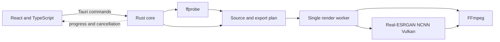

<p align="center">
  
</p>

<h1 align="center">Rex</h1>

<p align="center">Video should be good to watch.</p>

Rex is a desktop app for improving low-resolution video. It runs on macOS, Linux, and Windows.

## Why I built it

I kept finding videos I wanted to watch, then getting distracted by how bad they looked. Soft detail, compression blocks, uneven motion. I hated treating low quality as something viewers just had to accept.

The upscalers I found felt generic. They enlarged the picture, but left me to guess which settings would work, wait for a full render, and find out afterward. I wanted a tool built around the video someone will actually watch: its source, its motion, its frame, its sound, and the export it needs.

So I started building Rex. The goal is a clearer picture, fluid motion when it helps, and a result that is enjoyable to watch. Bigger numbers alone do not make a better video.

## Architecture

Rex has a small desktop UI and a local video-processing core. The UI sends typed commands to the Rust side through Tauri. The Rust core inspects the source, builds an export plan, runs the tools, and sends progress events back to the UI.



The queue runs one render at a time. A job can be cancelled while its helper process runs. Rex writes to a temporary output and moves it to the chosen path only after the render completes.

Video processing runs on the user's machine. Rex does not upload source files to a render service.

## Product thinking

Video quality is hard to judge from a slider. A number can say "4K" without telling you whether the result looks better. Rex tries to make the cost and likely result visible before a long render starts.

- Inspect the source and show its size, frame rate, color, and warnings.
- Render a three-second preview and compare the source with the result.
- Estimate output size and render time. Rex measures the selected pipeline on a short sample for its speed estimate.
- Check which encoders run on the current machine. Disable export sizes that the selected encoder cannot produce.
- Say when AI upscaling is unavailable or when resizing is all the job will do.

The default keeps the source frame shape, frame rate, and audio. Controls exist when they change the result: output size, AI mode, motion smoothing, canvas, quality, and export format.

Taste shows up in what the app refuses to promise. Upscaling can make a video easier to watch. It cannot restore details that were never captured.

## What I did not build

Rex is not a full video editor. It has no timeline, effects stack, title tools, or color-grading suite. It does not ask you to upload footage, create an account, or rent cloud compute.

I also did not train a proprietary model. Rex currently uses Real-ESRGAN models through `realesrgan-ncnn-vulkan`, with FFmpeg for video work. The product work is in making that pipeline fit a real video export: inspect the source, choose a workable plan, preview it, and handle the render cleanly.

## What I have not solved

An upscaler estimates new pixels from what remains in the source. It cannot know the exact texture hidden by low resolution, and it can invent detail that was not there. Rex's current AI path processes frames individually. Details can flicker between frames because the model does not understand motion across the video. Motion interpolation is a separate FFmpeg step and can create artifacts around fast movement or objects crossing in front of one another.

The model choice is deliberately limited today. Fast uses `realesr-animevideov3` at 2×. Clean uses `realesrgan-x4plus` at 4× when the requested enlargement needs it and the scale is allowed; otherwise it uses `realesr-animevideov3` at 2×. Neither choice is right for every kind of footage.

HDR sources currently export as SDR and may look flat. The app warns when it detects HDR. AI processing also depends on a working Vulkan setup and enough GPU memory. When the AI engine or its models are missing, Rex falls back to Lanczos resizing and says so.

## How an export works

1. `ffprobe` reads the video and audio streams, dimensions, frame rate, rotation, pixel aspect ratio, interlacing, color tags, and duration.
2. Rex plans the output dimensions and frame rate, checks the requested encoder, and estimates output size. It tests encoders by running a small encode, because an encoder can be listed by FFmpeg and still fail on a particular machine.
3. FFmpeg corrects rotation and pixel aspect ratio, deinterlaces when needed, converts color to BT.709, and makes the frame rate constant. Optional motion smoothing uses FFmpeg's `minterpolate` filter.
4. If an AI model is available and the output needs meaningful enlargement, FFmpeg decodes frames in chunks of 96. Real-ESRGAN enlarges each chunk. FFmpeg then fits the frames to the chosen canvas and encodes them.
5. Rex joins the encoded chunks, keeps compatible audio as-is or converts it for the selected export, then moves the completed file into place.

Without an AI model, FFmpeg handles the resize directly with Lanczos. Canvas options are original, 16:9, 9:16, and square. A non-original canvas can use black bars or a blurred copy of the video as its background.

Export profiles use HEVC for sharing, ProRes for editing, or H.264 for compatibility when the machine has a working encoder. The available sizes depend on that encoder, up to 8K.

## Run it locally

You need Bun, Rust, and the platform prerequisites for Tauri. At runtime, Rex looks for `ffmpeg`, `ffprobe`, and `realesrgan-ncnn-vulkan` beside the app or on `PATH`. AI upscaling also needs model files in the app's `models` resource directory. If the AI engine is unavailable, Rex can still resize with Lanczos as long as FFmpeg is available.

```sh
bun install
bun run tauri dev
```

Build a desktop bundle with:

```sh
bun run tauri build
```

The Tauri bundle targets macOS, Linux, and Windows. This repository does not currently declare the FFmpeg binaries, Real-ESRGAN binary, or model weights as bundle resources. A distributable build needs those platform-specific files packaged and tested for each target.

## License

This repository does not have a `LICENSE` file, so Rex does not yet declare an open-source license. Do not assume that the repository grants permission to redistribute the app. FFmpeg, Real-ESRGAN NCNN Vulkan, and the model weights have separate license terms. Check and include the terms for any third-party binaries or weights you distribute with Rex.
